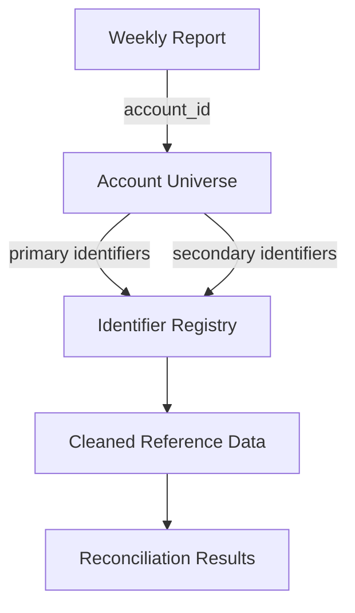

# Databricks Data Reconciliation Pipeline

A portfolio-safe data engineering project demonstrating the
modernization of a legacy spreadsheet-driven reconciliation workflow
into a production-style Python and Databricks pipeline.

## Project Goals

This project demonstrates:
```mermaid
flowchart TD

- Python data engineering
- PySpark transformations
- multi-source data reconciliation
- identifier extraction and matching
- address normalization and matching
- deterministic business rules
- audit trail generation
- automated quality gates
- Excel report generation
- Databricks workflow orchestration

## Architecture

Synthetic Input
→ Account Universe
→ Identifier Extraction
→ Reference Registry
→ Address Cleaning
→ Data Enrichment
→ Address Matching
→ Business Rules
→ Audit
→ Quality Gates
→ Excel Output
```

## Synthetic Data

The repository uses a fully synthetic data model designed to
reproduce common enterprise reconciliation challenges without
exposing proprietary information.



The sample data includes deterministic scenarios for exact matches,
partial matches, missing reference records, address normalization,
inactive identifiers, ended accounts, and manual-review exceptions.

All company names, people, identifiers, addresses, and business
scenarios in this repository are fictional.

## Data

All datasets in this repository are synthetic and were created
specifically for demonstration purposes.

No proprietary company data, credentials, internal table names,
customer information, or production code are included.

## Status

🚧 Portfolio project under development.
