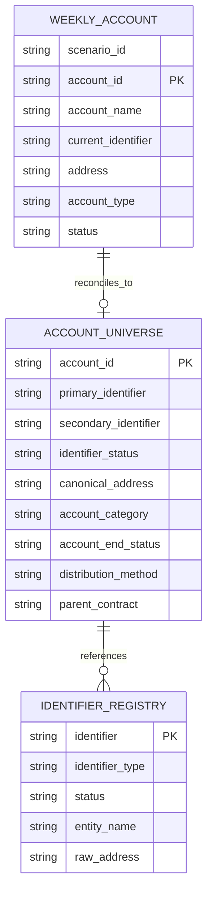
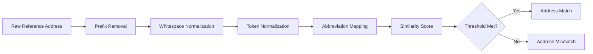
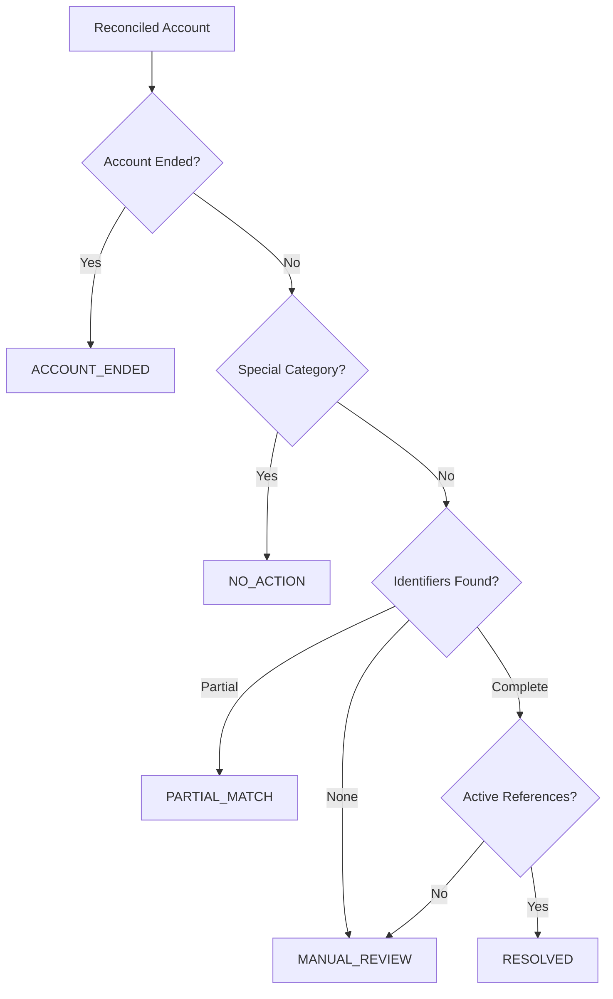
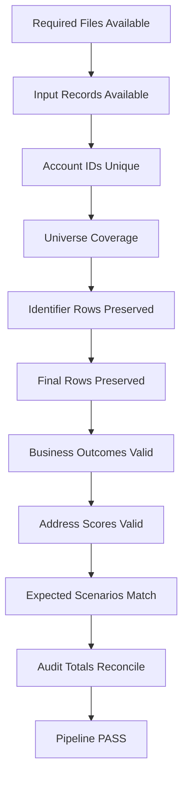
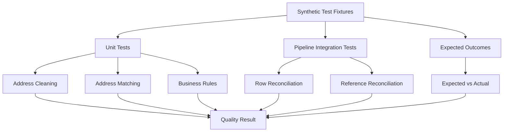
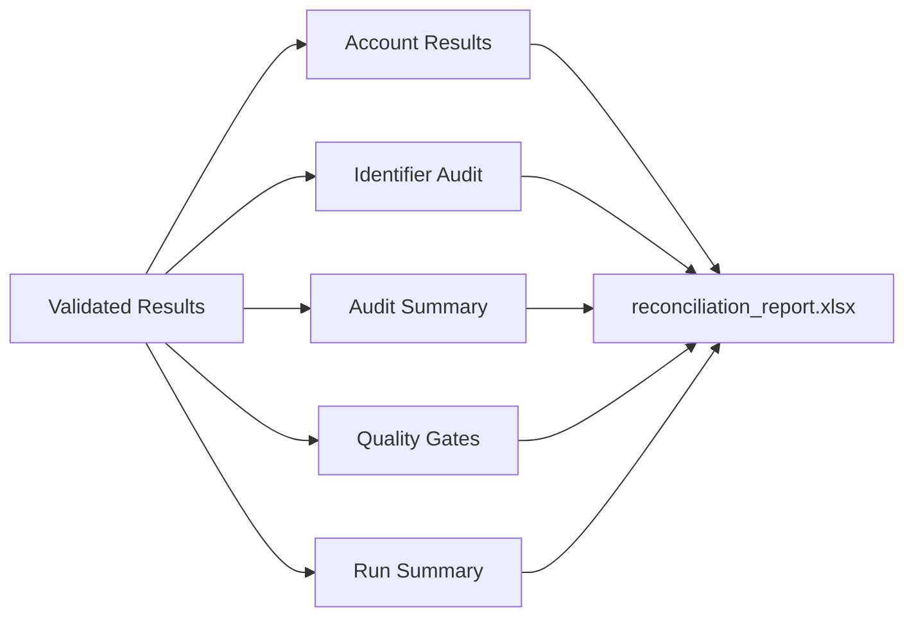
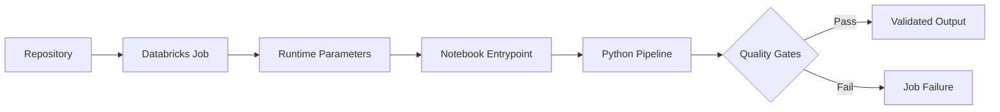

# Databricks Data Reconciliation Pipeline

A production-style data engineering case study demonstrating how a
legacy spreadsheet-driven reconciliation workflow can be redesigned
as a modular, deterministic, auditable Python pipeline with a
Databricks-oriented orchestration pattern.

The project focuses on:

- multi-source data reconciliation
- identifier extraction and reference matching
- address normalization and similarity matching
- deterministic business rules
- auditability and exception handling
- automated quality gates
- unit and integration testing
- validated Excel delivery
- Databricks job orchestration patterns

> **Portfolio-safe implementation**
>
> All organizations, people, identifiers, addresses, scenarios, and
> datasets in this repository are synthetic. The repository does not
> contain production code, proprietary datasets, credentials, internal
> infrastructure names, or confidential business information.

---

## The Problem

The original class of workflow represented by this project relied
heavily on spreadsheet operations, intermediate reference extracts,
manual reconciliation, and workbook-based business logic.

That approach creates several engineering challenges:

- processing logic becomes coupled to spreadsheet structure
- reference lookups are difficult to audit end-to-end
- business rules are harder to test independently
- failures may surface late in the workflow
- intermediate files become part of the execution engine
- quality validation frequently depends on manual review

The modernization goal was not simply to automate spreadsheet clicks.

The goal was to make the reconciliation workflow deterministic,
modular, testable, and observable while retaining Excel as a familiar
delivery format.

---

## Modernization Journey


The key architectural change is that Excel becomes an **output
artifact**, not the processing engine.

---

## Architecture


Three types of synthetic data participate in the reconciliation:

1. a weekly account report
2. an authoritative account universe
3. an identifier registry

The pipeline reconciles these sources and determines a deterministic
outcome for each account.

---

## Modular Architecture

The implementation separates responsibilities into small modules
rather than concentrating the workflow inside a monolithic script.


This structure allows individual transformations to be tested,
explained, modified, or replaced independently.

---

## Synthetic Data Model

The repository contains deterministic synthetic fixtures rather than
randomly generated records.



### Synthetic input files

```text
data/input/
└── weekly_accounts_report.xlsx

data/reference/
├── account_universe.csv
└── identifier_registry.csv

data/expected/
├── scenario_expectations.csv
└── account_expectations.csv
```

The synthetic workbook contains two populations:

- `ORGANIZATIONS`
- `PROFESSIONALS`

---

## Controlled Reconciliation Scenarios

The fixtures deliberately exercise different branches of the
pipeline.

| Scenario | Expected engineering behavior |
|---|---|
| Exact match | Full reconciliation |
| Address abbreviation | Normalize STREET/ST, ROAD/RD, etc. |
| Address prefix | Remove non-address prefixes |
| Missing primary identifier | Partial reconciliation |
| Missing secondary identifier | Partial reconciliation |
| Missing identifiers | Manual-review exception |
| Inactive identifier | Status-aware validation |
| Ended account | Account-ended business outcome |
| Special account category | No-action business rule |
| Multiple identifiers | One-to-many identifier extraction |
| Unresolved exception | Analyst-review outcome |

The expected outcomes are stored separately from the transformation
logic so the pipeline can validate actual results against known
fixtures.

---

## Address Processing

Reference addresses can contain prefixes, formatting differences, or
common abbreviations.

The pipeline first cleans reference data and then calculates a
normalized address similarity score.



Examples of normalized equivalences include:

```text
STREET → ST
ROAD → RD
AVENUE → AVE
BOULEVARD → BLVD
DRIVE → DR
```

The portfolio implementation uses a token-based similarity strategy
that is simple to explain, deterministic, and independently testable.

---

## Deterministic Business Rules

After reference reconciliation and address processing, each account
receives an explicit outcome.

Example outcomes include:

```text
RESOLVED
PARTIAL_MATCH
MANUAL_REVIEW
ACCOUNT_ENDED
NO_ACTION
```



Business rules remain independent from ingestion and reporting code,
which makes them straightforward to unit test.

---

## Quality Engineering

The pipeline uses explicit quality gates rather than silently
continuing when reconciliation assumptions break.



When a gate fails, the pipeline raises an explicit error describing the
failed reconciliation rather than producing an incomplete artifact.

This separates two very different situations:

```text
source data contains an intentional exception
```

from:

```text
the pipeline lost or incorrectly transformed data
```

---

## Test Strategy

The project combines function-level tests with end-to-end scenario
validation.



Test coverage includes:

- workbook ingestion
- address cleaning
- address normalization
- similarity scoring
- business-rule precedence
- duplicate account detection
- invalid outcome detection
- quality-gate failure behavior
- pipeline integration
- Excel artifact validation

Tests are implemented with `pytest`.

---

## Excel Delivery

The spreadsheet is treated as a delivery artifact rather than an
execution engine.



The generated workbook contains five analyst-facing sheets:

1. `Account Results`
2. `Identifier Audit`
3. `Audit Summary`
4. `Quality Gates`
5. `Run Summary`

After generation, the workbook is reopened and validated to confirm:

- the file exists
- required worksheets are present
- the final account count reconciles
- the artifact is non-empty

---

## Databricks-Oriented Orchestration

The core pipeline remains portable Python, while the repository also
demonstrates how the same processing layer can sit behind a
lightweight Databricks notebook entrypoint.



The notebook contains orchestration logic only. Transformation,
reconciliation, and business rules remain under `src/`.

### Execution contract

A successful orchestrated execution requires:

```text
status = SUCCESS
failed_checks = 0
```

Otherwise the notebook raises an exception so the workflow can be
reported as failed.

The repository includes:

```text
notebooks/databricks_pipeline_demo.py
docs/databricks-deployment.md
docs/job-config.example.json
```

The Databricks configuration is illustrative and intentionally
contains no production workspace information.

---

## Local Execution

### 1. Install dependencies

```bash
python -m pip install -r requirements.txt
```

### 2. Recreate the synthetic fixtures

```bash
python scripts/generate_synthetic_data.py
```

### 3. Execute the pipeline

```bash
python -m src.pipeline
```

### 4. Run the tests

```bash
pytest -v
```

### 5. Review the output

```text
output/reconciliation_report.xlsx
```

---

## Repository Structure

```text
databricks-data-reconciliation-pipeline/
│
├── README.md
├── requirements.txt
│
├── data/
│   ├── input/
│   ├── reference/
│   └── expected/
│
├── scripts/
│   └── generate_synthetic_data.py
│
├── src/
│   ├── config.py
│   ├── ingestion.py
│   ├── universe.py
│   ├── identifiers.py
│   ├── reference_lookup.py
│   ├── address_cleaning.py
│   ├── enrichment.py
│   ├── address_matching.py
│   ├── business_rules.py
│   ├── audit.py
│   ├── quality_gates.py
│   ├── excel_output.py
│   └── pipeline.py
│
├── tests/
│
├── notebooks/
│   └── databricks_pipeline_demo.py
│
├── docs/
│   ├── data-model.md
│   ├── databricks-deployment.md
│   └── job-config.example.json
│
└── output/
```

---

## Technology Stack

| Area | Technology |
|---|---|
| Core language | Python |
| Data processing | pandas |
| Distributed architecture | Databricks / PySpark pattern |
| Testing | pytest |
| Excel generation | openpyxl |
| Orchestration design | Databricks Jobs |
| Version control | GitHub |
| Documentation | Markdown + Mermaid |

The public reference implementation intentionally uses `pandas` so
the project can be executed without requiring access to a Databricks
workspace.

---

## Engineering Decisions

### Excel is an output, not an execution engine

Moving business logic into Python makes transformations testable and
removes workbook structure as a processing dependency.

### Expected outcomes are independent test fixtures

Known scenarios are stored separately from implementation code so
tests validate behavior rather than reproduce the implementation.

### Exceptions are not pipeline failures

A missing reference or unresolved account can be a legitimate
business outcome. Quality gates detect structural failures separately
from business exceptions.

### Orchestration is separated from processing

The Databricks notebook is deliberately lightweight. The reusable
pipeline resides in `src/`, making local execution, testing, and
managed orchestration variations of the same design.

---

## What I Learned

This project reinforced several principles that are now central to how
I approach automation:

1. **Automating the existing interface is not the same as modernizing
   the process.**
   Moving spreadsheet logic into deterministic services creates a
   much stronger foundation than simply automating workbook actions.

2. **Reconciliation pipelines need explicit evidence of completeness.**
   Counts, audit tables, expected outcomes, and quality gates make it
   possible to explain where a discrepancy originated.

3. **Business exceptions and engineering failures are different.**
   A legitimate manual-review case should not be treated like a broken
   pipeline.

4. **Modularity makes migration easier.**
   Keeping transformation logic independent from orchestration makes
   the same architecture portable between local Python and managed
   environments such as Databricks.

5. **Synthetic fixtures can preserve the engineering story without
   exposing enterprise information.**
   This repository recreates the technical challenges with completely
   fictional data.

---

## Future Extensions


Potential extensions include:

- event-driven file ingestion
- managed Databricks scheduling
- a distributed PySpark reference implementation
- persistent historical run auditing
- operational quality dashboards
- automated notification on failed quality gates
- agent-assisted investigation of manual-review exceptions

---

## Data Privacy

This repository contains only synthetic portfolio data.

It does **not** contain:

- proprietary company datasets
- production code
- production outputs
- real healthcare identifiers
- customer records
- credentials
- internal table or catalog names
- tenant identifiers
- corporate documentation
- workspace URLs
- service-principal information

Identifier formats such as `PRI-A001` and `SEC-H001` are deliberately
fictional and have no relationship to real-world healthcare
identifiers.

---

## Project Purpose

This project is a portfolio case study focused on data engineering,
automation modernization, reconciliation design, quality engineering,
and Databricks-oriented orchestration.

The implementation is intentionally synthetic, but the engineering
principles are designed to reflect real production constraints:
reproducibility, deterministic transformations, traceability,
failure visibility, and maintainability.
