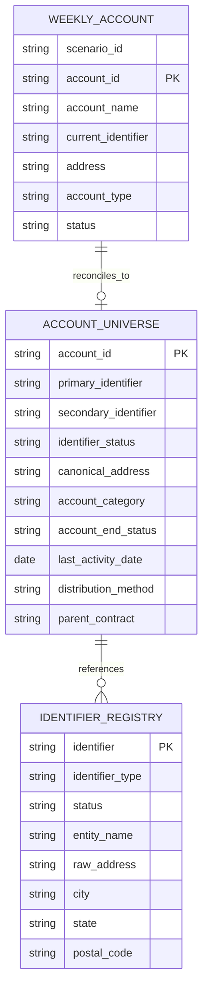
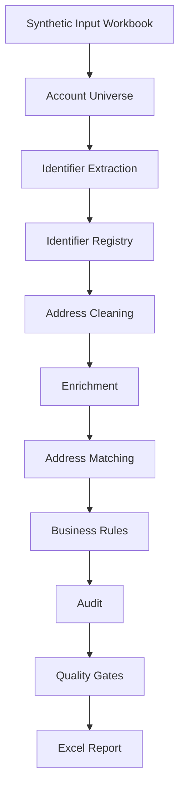
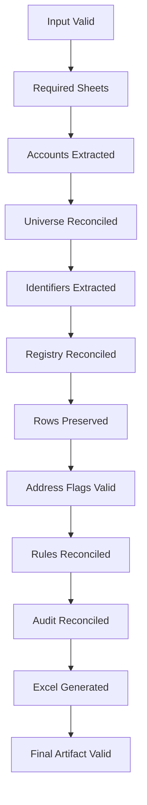

# Databricks Data Reconciliation Pipeline

A production-style data engineering project demonstrating how a
legacy spreadsheet-driven reconciliation workflow can be modernized
into a modular Python and Databricks pipeline.

The project focuses on deterministic transformations, reference-data
reconciliation, address matching, business rules, auditability,
quality gates, and automated Excel delivery.

> **Portfolio-safe project:** all datasets, organizations, people,
> identifiers, addresses, and scenarios in this repository are
> synthetic.

---

## Architecture


---

## Modernization Journey


The objective is not merely to automate Excel operations. The
workflow is redesigned so that the spreadsheet becomes a delivery
artifact rather than the execution engine.

---

## Synthetic Data Model



---

## Demonstrated Scenarios

The synthetic dataset intentionally contains controlled cases rather
than randomly generated rows.

| Scenario | Engineering behavior |
|---|---|
| Exact match | Full reconciliation |
| Address abbreviation | STREET/ST and ROAD/RD equivalence |
| Address prefix | Reference-address cleanup |
| Missing primary identifier | Partial reconciliation |
| Missing secondary identifier | Partial reconciliation |
| Missing identifiers | Manual-review exception |
| Inactive identifier | Status-aware validation |
| Ended account | Business-rule outcome |
| Special account category | No-action rule |
| Multiple identifiers | One-to-many identifier extraction |
| Unresolved exception | Analyst review |

---

## Pipeline Design



---

## Quality Engineering

The project will implement deterministic quality gates throughout the
pipeline.



Failures should identify the pipeline stage where reconciliation
broke rather than silently producing an incomplete report.

---

## Repository Structure

```text
databricks-data-reconciliation-pipeline/
│
├── data/
│   ├── input/
│   ├── reference/
│   └── expected/
│
├── scripts/
│   └── generate_synthetic_data.py
│
├── src/
│   ├── ingestion.py
│   ├── universe.py
│   ├── identifiers.py
│   ├── reference_lookup.py
│   ├── address_cleaning.py
│   ├── enrichment.py
│   ├── address_matching.py
│   ├── business_rules.py
│   ├── audit.py
│   ├── excel_output.py
│   └── pipeline.py
│
├── tests/
├── notebooks/
├── docs/
└── output/
```

---

## Technology Stack

- Python
- pandas
- PySpark
- Databricks
- openpyxl
- pytest
- GitHub

---

## Current Status

- [x] Repository structure
- [x] Synthetic data model
- [x] Controlled reconciliation scenarios
- [x] Synthetic data generator
- [ ] Modular pipeline
- [ ] Automated quality gates
- [ ] Excel reporting
- [ ] Databricks workflow demo
- [ ] Portfolio case study

---

## Data Privacy

This repository does **not** contain production code, proprietary
table names, credentials, customer records, real healthcare
identifiers, internal company documentation, or production outputs.

Identifier formats such as `PRI-A001` and `SEC-H001` are deliberately
fictional and have no relationship to real-world healthcare
identifiers.
