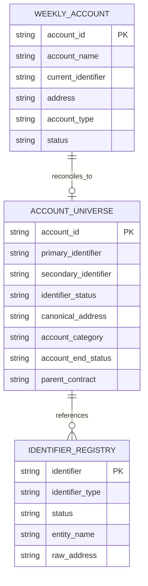

# Synthetic Data Model

All datasets in this project are synthetic and were designed
specifically to demonstrate reconciliation and data-quality patterns.

No production data or proprietary identifiers are included.

## Data Flow

## Source Model

## Synthetic Scenarios

The sample data intentionally includes:

- exact identifier matches
- missing identifiers
- multiple identifiers
- inactive identifiers
- address abbreviation differences
- address prefixes requiring cleaning
- ended accounts
- special account categories
- unresolved cases requiring manual review
