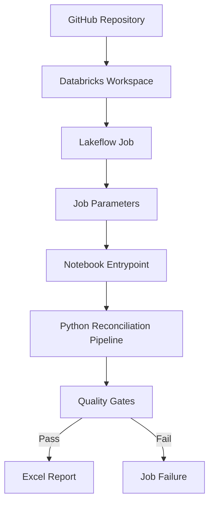

# Databricks Deployment

The portfolio version of the reconciliation pipeline is designed to
run both as a standard Python project and as a Databricks notebook
task.

All input datasets used in this implementation are synthetic.

## Deployment Architecture



## Notebook Task

The Databricks notebook entrypoint is:

```text
notebooks/databricks_pipeline_demo.py
```

The notebook has intentionally minimal logic. Business rules remain
inside the modular Python package under `src/`.

This keeps orchestration separate from transformation logic.

## Parameters

The demo notebook accepts:

| Parameter | Default | Purpose |
|---|---:|---|
| `environment` | `demo` | Identifies the execution context |

Additional file or storage parameters could be introduced without
changing the reconciliation modules.

## Job Configuration

A representative Databricks Job can be configured as:

```text
Job
└── Run_Reconciliation_Pipeline
    ├── Type: Notebook
    ├── Source: Workspace or Git
    ├── Parameter: environment=demo
    └── Max concurrent runs: 1
```

## Execution Contract

```mermaid
stateDiagram-v2
    [*] --> Started
    Started --> Pro*essing

    Processing --> Quality*alidation

    QualityValidation -*> Succeeded:*all gates pass
    QualityValidati*n --> Failed: any*gate fails

    Succeeded --> Exce*Generated
    Excel*enerated --> [*]

    Failed --> [*]
```

A successful execution mus* satisfy both:

```text
status == *UCCESS
failed_checks == 0
```

The*job should fail explicitly when ei*her condition is not met.

## Prod*ction Design Principles

The desig* separates three responsibilities:*
1. **Orchestration**
*  - Databricks Job
  *- runtime parameters
   - executio* state

2. ***rocessing**
   - deterministic Pyt*on modules
   -*reconciliation
   - address normal*zation
   - business rules

3. **O*servability**
   - audit output
  *- quality gates
   - run summary
 * - validated Excel artifact

This *eparation makes the workflow easie**to test and migrate between
local*Python execution and Databricks or*hestration.

##*Portfolio Safety

This deployment *ocumentation intentionally exclude*:

- workspace URLs
- tenant ident*fiers
- cluster identifiers
- prod*ction catalogs
- internal table na*es
- corporate credentials
- servi*e principals
- production screensh*ts
- proprietary datasets
